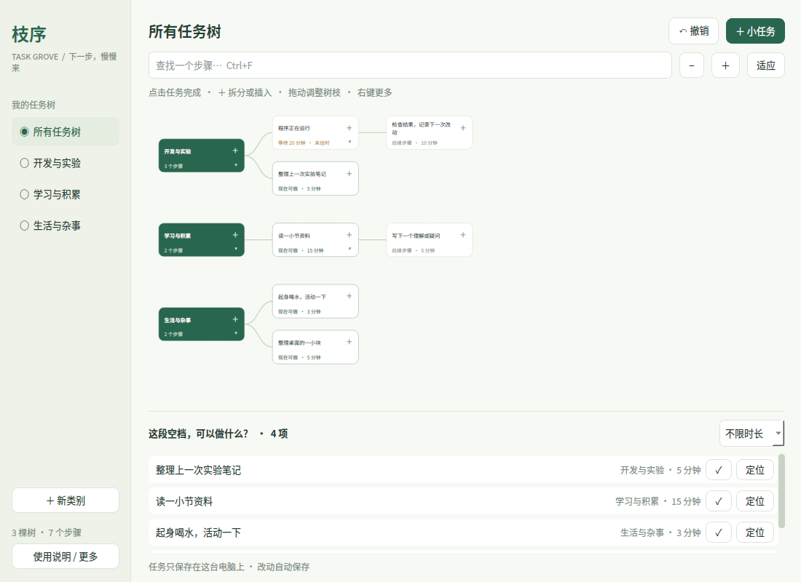
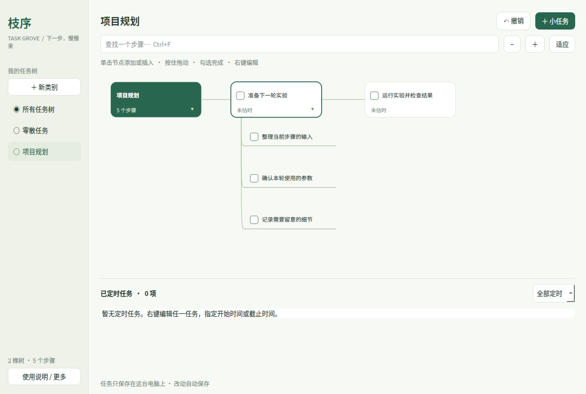
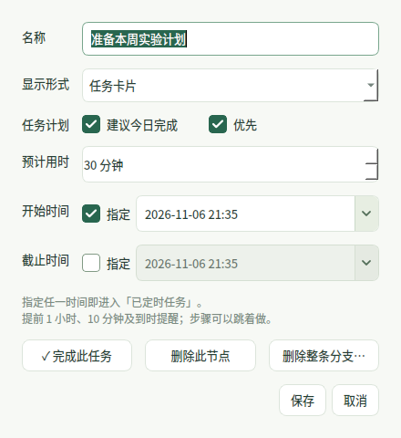

# 枝序 · Task Grove

**思维导图式任务拆解与管理器**

[](https://github.com/cya99999/task-grove/actions/workflows/tests.yml)

用思维导图的方式拆解任务，把大目标、步骤和分支放在同一张可编辑的任务树上。从梳理思路到安排时间、推动执行，在一个桌面窗口中完成。

一类工作是一棵树，具体步骤随时添在树枝上。适合项目拆解、开发实验、学习规划和日常事务管理；支持按实际进展跳步处理，帮助你在多项工作交错时看清下一步。

原生 Python / Qt 桌面应用，任务离线保存，不需要账号或服务器。



## 产品定位

枝序将思维导图的结构化拆解与任务管理结合：用树干划分工作领域，用分支细化目标和步骤，通过拖拽重组计划，通过勾选完成推进任务，再用开始/截止时间与提醒管理执行节奏。

- **拆解**：随时分出子步骤，在已有步骤前后插入新动作。
- **梳理**：总览中收起细节，进入单棵树展开查看；跨类别拖动整条分支。
- **推进**：可以跳步完成，移除节点后保留并接续后面的工作。
- **安排**：把指定时间的节点汇总为定时任务，提前 1 小时、10 分钟及到时提醒。

## 安装与启动

### 环境要求

当前主要支持并验证 **Ubuntu 24.04 / GNOME / X11**。需要 Python 3.10 或更新版本、Git，以及可用的图形桌面。Python 依赖固定在 `pyproject.toml` 中，通过虚拟环境安装。搜狗/Fcitx 用户还需要完成下方「搜狗中文输入」配置。

Ubuntu 首次安装时准备运行环境：

```bash
sudo apt-get update
sudo apt-get install -y python3 python3-venv git libegl1 libopengl0 \
  libxcb-cursor0 libxkbcommon-x11-0 libxcb-icccm4 libxcb-keysyms1 \
  libxcb-image0 libxcb-render-util0 libxcb-xinerama0 fonts-noto-cjk libnotify-bin
```

Ubuntu 的 GNOME 桌面一般已启用 AppIndicator 托盘扩展；若看不到托盘，检查「扩展」里的 Ubuntu AppIndicators 是否启用。

### 下载、安装与启动

```bash
git clone https://github.com/cya99999/task-grove.git
cd task-grove
python3 -m venv .venv
.venv/bin/python -m pip install -e .
.venv/bin/python install.py
./run.sh
```

`install.py` 添加应用菜单入口，并启用当前用户登录桌面后自启动。应用菜单搜索「枝序」，或点击系统托盘中的树枝图标打开/收起窗口。Ubuntu GNOME 需要 AppIndicator 扩展；没有托盘时会保留任务栏入口。自启动可以从「使用说明 / 更多」关闭。

首次使用始终有一棵「零散任务」，用于收纳尚未归类的动作。它可以添加和移动任务，树干不能删除或重命名。点击左侧「＋ 新类别」建立自己的任务树。

## 配置方法

| 配置项 | 设置位置 / 方法 |
| --- | --- |
| 开机登录自启动 | 运行 `install.py` 默认开启；在「使用说明 / 更多 → 登录桌面时自动启动」开关 |
| 窗口置顶 | 「使用说明 / 更多 → 窗口置顶」 |
| 开始时间 / 截止时间 | 右键任务，在对应日期框左侧勾选「指定」，再填写日期和时分；取消勾选清除该时间 |
| 通知筛选 | 底部「已定时任务」右侧选择全部定时、今日任务或已逾期 |
| 系统通知 | Ubuntu「设置 → 通知」中允许通知，测试提醒时关闭勿扰模式 |
| 搜狗中英文模式 | 沿用打开编辑器之前的模式；首次配置兼容插件见下方说明 |
| 备份和恢复 | 「使用说明 / 更多 → 导出任务备份 / 导入任务备份」 |

日期使用电脑的本地时区；如需修改时区，在系统「日期与时间」中设置。所有任务都可以单独指定开始、截止时间，也可以完全不定时。时间框未启用时为浅灰色，启用后为白底，勾选为绿色底白勾。

如需独立测试空间或另一套任务数据，可以指定数据目录：

```bash
./run.sh --data-dir /tmp/task-grove-demo
```

`--data-dir` 只影响这次启动；系统菜单和登录自启动默认继续使用 `~/.local/share/task-grove`。应用也遵守 `XDG_DATA_HOME`、`XDG_CONFIG_HOME`。把项目移动到新位置后，重新运行 `.venv/bin/python install.py` 更新菜单和自启动路径。

### 常见问题

- **无法输入中文**：确认搜狗/Fcitx 本身正常，再按下方步骤构建匹配 Qt 版本的插件，退出枝序后重新启动。无需修改桌面全局输入法配置。
- **启动提示缺少 xcb 插件依赖**：先完成上面的 Ubuntu 运行环境安装，然后从终端执行 `./run.sh` 查看具体缺少的库。
- **没有通知**：确认枝序仍在托盘运行、任务已指定时间、系统通知和勿扰设置允许显示。应用完全退出时不会发通知；重新运行会补发已错过的最近阶段。
- **任务时间框不能编辑**：先勾选对应时间旁的「指定」。

## 编辑任务树

- **单击节点**：选中节点并直接打开添加/插入菜单；节点上不再放加号按钮。按住拖动时移动整条分支。
- **勾选节点左侧方框**：完成并移除该步，所有后续分支按原顺序接到前面。可以直接完成任意层级的步骤。
- **右键节点**：直接打开编辑页面，修改名称、预计时长、开始时间、截止时间。也可完成、删除此节点（保留后续）或删除整条分支（确认后执行）。
- **添加菜单**：单击节点，可添加后续步骤、在前后插入、添加同层任务，或补充当前步骤的细节。
- **拖动到节点中间**：接为其后续。拖到上/下边缘：在同层前/后排列。拖到左侧类别名：移到该类别。绿色提示显示放置位置，循环连接会被拒绝。
- **折叠和概览**：点击节点右下角的小箭头。进入「所有任务树」默认只显示各类别树干；点击箭头临时展开，或点击左侧类别查看步骤。

树枝只帮助梳理工作，不限制先做哪个步骤。新建任务会定位到其类别。查看所有树时，顶部「＋ 小任务」默认收到「零散任务」。

## 细分支：补充当前步骤的细节



单击任意节点，选择「补充当前步骤的细节（每行一项）」。每一行是当前步骤的一条附属细节，使用文字和横线显示在当前节点下方略向右的位置，横线左端连接当前节点。

**细节属于当前步骤，不是后续步骤。** 它们单独存放、单独绘制，不占用向右延伸的后续任务主线，也不会和之后的节点混在同一层级。完成当前步骤时，其附属细节一起移除，后续步骤继续接到前面；可用 `Ctrl+Z` 撤销。

细节仍支持单独勾选、拖动、右键编辑和定时；整批新增可一次撤销。任务编辑页可将节点转换为母节点的细节，或转回普通任务。旧版误放在后续层级中的横线节点会自动迁移为母节点的附属细节，迁移前保留备份。

## 定时任务与提醒



编辑任务时可分别勾选「开始时间」和「截止时间」，用日期选择器填写本地日期时间。两者可只设一个；同时设置时，截止时间不能早于开始时间。取消勾选即可清除对应时间。

只要指定任一时间，就进入底部「已定时任务」。列表跨全部类别收集，包含树枝深处的节点，不受前面步骤是否完成影响。支持「全部定时」「今日任务」「已逾期」筛选；点击「定位」回到树中，点击 ✓ 完成。

对开始时间和截止时间分别提醒：

| 距离指定时间 | 通知 |
| --- | --- |
| 1 小时 | 提前提醒 |
| 10 分钟 | 临近提醒 |
| 到时 | 开始 / 截止提醒 |

- 每次开机登录后，汇总当天尚未完成的定时任务；跨天运行时也会更新当天汇总。
- 同一任务、同一时间的每个提醒阶段只发送一次，退出重开仍会去重。改动时间后，按新时间提醒。
- 休眠或关机跨过多个阶段时，下次运行只补发最近阶段，不连续重放过时通知。
- 通知每 10 秒检查一次，不会自动完成或删除任务。程序退出期间不发通知，系统勿扰模式可能隐藏弹窗。
- 旧版「等待时间」会迁移为开始时间，任务内容和树枝保持不变。

## 快捷键与窗口

| 操作 | 快捷键 |
| --- | --- |
| 新增任务 / 类别 | `Ctrl+N` / `Ctrl+Shift+N` |
| 撤销 / 重做 | `Ctrl+Z` / `Ctrl+Shift+Z` |
| 查找步骤（自动展开并定位） | `Ctrl+F` |
| 缩放 | `Ctrl+滚轮`、工具栏 − / ＋ |
| 移动画布 | 拖动空白处或使用滚动条 |
| 收到托盘 | `Esc`、关闭、最小化 |
| 完全退出 | 托盘或更多菜单 → 退出枝序 |

同一数据目录只运行一个实例，再次启动唤起原窗口。窗口位置、尺寸和最大化状态会保留，新建/编辑不会把最大化窗口缩小。「更多」还可以开启窗口置顶。

## 数据与备份

```text
~/.local/share/task-grove/tasks.json       # 当前任务树
~/.local/share/task-grove/tasks.json.bak   # 前一次成功保存
~/.local/share/task-grove/reminders.json   # 已发送提醒记录
~/.config/autostart/task-grove.desktop    # 登录启动
~/.local/share/applications/task-grove.desktop
```

遵守 `XDG_DATA_HOME` / `XDG_CONFIG_HOME`。每次修改都会验证结构并原子保存。主文件损坏时尝试从备份恢复，并保留损坏原文件。无法恢复时报告错误，不会自动清空数据。

从更多菜单导出/导入 JSON。导入替换当前树，可以撤销；未包含「零散任务」的旧备份会自动补齐它。最近 100 次修改可在当前会话撤销；退出后不保留撤销记录。

任务内容、个人备份、提醒记录、输入法二进制和虚拟环境均不提交到 Git。移动项目目录后，请重新运行 `install.py` 更新启动路径。卸载时先退出应用，再删除以下两个入口及仓库，个人任务数据会保留：

```bash
rm -f ~/.config/autostart/task-grove.desktop
rm -f ~/.local/share/applications/task-grove.desktop
```

## 搜狗中文输入（Ubuntu / Fcitx 4）

搜狗使用 Fcitx 4；PySide6 的官方 wheel 默认不包含 Fcitx 插件。Ubuntu 的系统插件依赖系统 Qt 私有 ABI，不能直接复制给不同版本的 Qt。本项目在启动前为应用加载 `.qt-plugins/<Qt版本>/platforminputcontexts/` 中匹配的插件；只向 Qt 暴露这个专用目录，避免混入系统平台插件。尊重已有的 `QT_IM_MODULE`，不会修改桌面全局输入法设置。新编辑窗口等输入上下文就绪后，继承打开前的中英文模式，不固定为英文或中文。

当前本机已构建并验证 Qt 6.12.0 专用插件：通过真实 X11 键盘事件输入 `zhongwen` 并选词，编辑框得到「中文」。依赖固定为已验证版本；升级 Qt 后需要重新构建。二进制插件和 SDK 不进入 Git，下面是新机器上的重建方法（无需 sudo）：

```bash
python3 -m venv /tmp/task-grove-buildenv
/tmp/task-grove-buildenv/bin/python -m pip install aqtinstall
/tmp/task-grove-buildenv/bin/python -m aqt install-qt linux desktop 6.12.0 linux_gcc_64 --archives qtbase --outputdir /tmp/task-grove-sdk
mkdir -p /tmp/task-grove-deps
(cd /tmp/task-grove-deps
 apt-get download extra-cmake-modules libxkbcommon-dev libgl-dev libglx-dev libopengl-dev libegl-dev libglvnd-core-dev
 for deb in *.deb; do dpkg-deb -x "$deb" root; done)
.venv/bin/python scripts/build_fcitx_plugin.py --qt-prefix /tmp/task-grove-sdk/6.12.0/gcc_64 --dev-prefix /tmp/task-grove-deps/root/usr
```

需要本机已有 CMake、Ninja、G++ 和搜狗/Fcitx。脚本下载固定版本的 [Fcitx 官方插件源码](https://github.com/fcitx/fcitx-qt5/tree/c328b03f32a4276d9aeb3213d1f3f959ef6848f2)，在临时目录编译、验证后安装到应用专用目录，并保留上游许可证。退出并重新打开枝序后生效。插件自身遵守上游许可证，不适用本项目的 MIT 许可证。

## 开发与测试

```bash
.venv/bin/python -m unittest discover -s tests -v
./run.sh --data-dir /tmp/task-grove-demo
```

测试包含分支接续、前后插入、跨类别迁移、循环保护、常驻零散任务、旧数据迁移、原子保存失败、损坏恢复、导入导出、Qt 点击/右键/拖放、日期编辑、最大化状态，以及开始和截止时间的三级提醒、重启去重、休眠补发、每日汇总。GUI 测试使用 Qt offscreen，不操作日常任务。

使用 [Qt Graphics View](https://doc.qt.io/qtforpython-6/overviews/qtwidgets-graphicsview.html) 绘制树，通过 [QSystemTrayIcon](https://doc.qt.io/qt-6/qsystemtrayicon.html) 集成托盘。Linux 通知优先使用 `notify-send`，没有时回退到 Qt 托盘通知。

MIT License。Qt / PySide6、Fcitx 插件遵守各自许可证。
